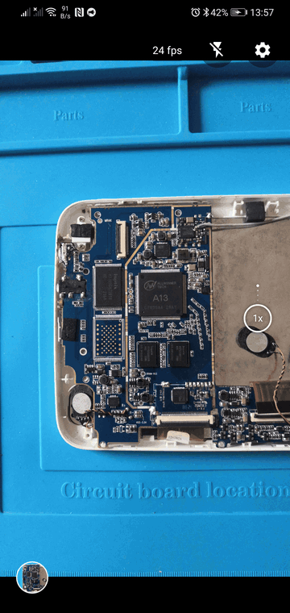
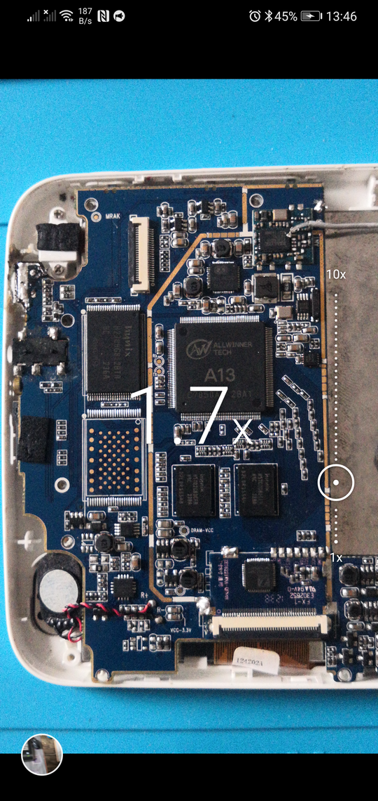
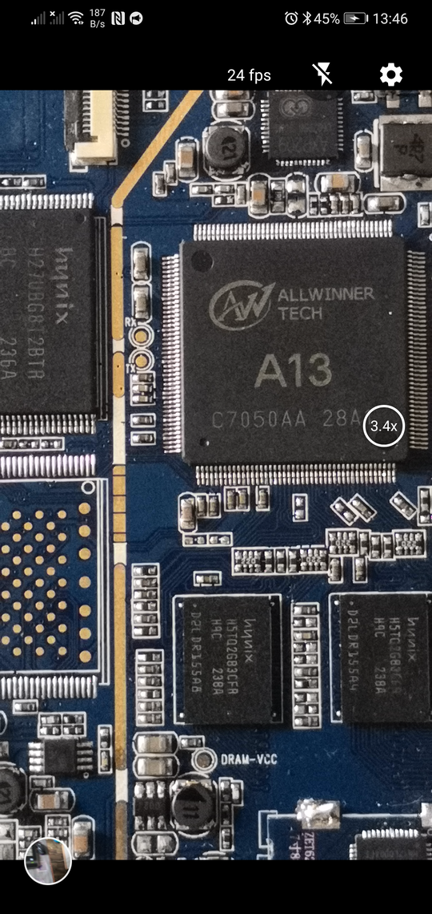
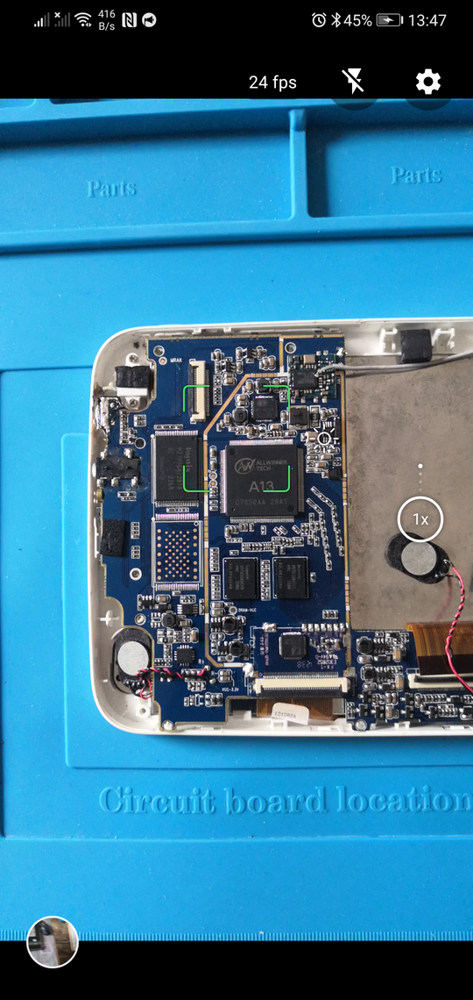
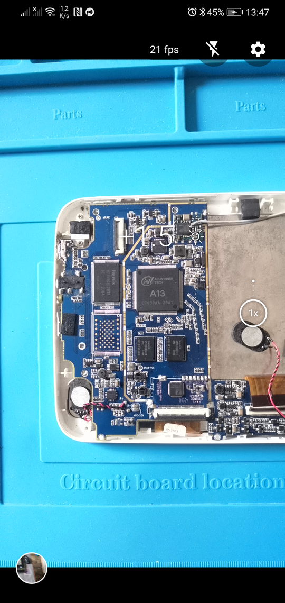
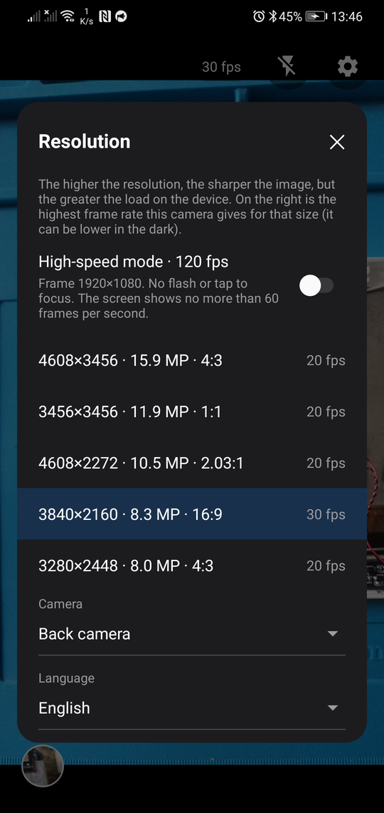

<div align="center">


# NoSleepCam

**An Android camera that never falls asleep.**<br>
It opens the camera and keeps it live for as long as the app is open — and starts in a fraction of a second.

[](https://github.com/Nazar356/NoSleepCam/actions/workflows/ci.yml)
[](LICENSE)
[](https://github.com/Nazar356/NoSleepCam/commits/main)
[](https://github.com/Nazar356/NoSleepCam)
[](https://github.com/Nazar356/NoSleepCam/issues)
[](https://github.com/Nazar356/NoSleepCam/stargazers)

-3DDC84?logo=android&logoColor=white)


<br>



<sub>Zoom · flash · tap to focus · brightness · settings · photo on double tap</sub>

</div>

<br>

## Why this app exists

The author uses a phone as a **digital microscope** — for example, to repair microelectronics: soldering SMD parts, inspecting
traces and chips under magnification. For that the camera image must be live **all the time**.

The stock camera app on the phone, and every other camera app the author could find on Google Play, do not keep the camera
active: after a while the camera "falls asleep" and the preview stops, so the picture has to be woken up again in the middle of
the work. NoSleepCam does the opposite — the screen stays on, the camera stays open for as long as the app is open, and if
the camera is taken away (another app, a driver error) the app reconnects on its own.

Everything else — a minimal interface, a Huawei-style zoom slider with up to 10x, tap to focus, brightness, the real frame rate,
flash as a work light, full-size photos on a double tap — serves that one purpose.

The app is also a full rewrite of the author's earlier .NET MAUI app `AlwaysOnCamera` in Kotlin: the MAUI version started
slowly (≈ 1.8 s), and the Kotlin one shows the camera in a fraction of that.

| | |
|---|---|
| 🌙 **Never sleeps** | the screen stays on and the camera reconnects on its own if it is lost |
| ⚡ **Fast** | camera opened ≈ 100 ms after process start, `TotalTime` ≈ 230–450 ms on a Honor 10 |
| 🎯 **Minimal** | just the camera, a zoom slider, the real frame rate, flash and settings |
| 🪶 **Lean** | no AndroidX, no Material — only framework widgets and the Kotlin stdlib |

## Contents

- [Why this app exists](#why-this-app-exists)
- [Screenshots](#screenshots)
- [Features](#features)
- [Build and install](#build-and-install)
- [Development](#development)
- [Fast startup](#fast-startup)
- [Tap to focus on the Honor 10](#tap-to-focus-on-the-honor-10)
- [Project structure](#project-structure)
- [Differences from the MAUI version](#differences-from-the-maui-version)
- [Known limitations](#known-limitations)
- [License](#license)

## Screenshots

<table>
  <tr>
    <td align="center" width="33%">
      <br>
      <sub><b>Always-on camera</b><br>frame rate, flash, settings and the zoom slider</sub>
    </td>
    <td align="center" width="33%">
      <br>
      <sub><b>Zoom scale</b><br>logarithmic, up to 10x on the Honor 10</sub>
    </td>
    <td align="center" width="33%">
      <br>
      <sub><b>Zoomed in</b><br>the ring shows the current value</sub>
    </td>
  </tr>
  <tr>
    <td align="center" width="33%">
      <br>
      <sub><b>Tap to focus</b><br>four-corner indicator and the brightness “sun”</sub>
    </td>
    <td align="center" width="33%">
      <br>
      <sub><b>Brightness</b><br>drag the sun for exposure compensation</sub>
    </td>
    <td align="center" width="33%">
      <br>
      <sub><b>Settings</b><br>resolution, high-speed mode, camera, language</sub>
    </td>
  </tr>
</table>

## Features

### Always on

- **The camera is always on.** The screen does not turn off while the app is open. If the camera is lost (taken by another
  app, a driver error), the app reconnects on its own. When the app is minimized the camera is released, and when you come
  back it is turned on again.
- **Minimum of elements on screen:** the camera (fitted with black bars, without distortion, any orientation), a zoom slider
  on the right and, in the top right corner, the **actual frame rate** badge, the flash and the gear (settings).
  In **landscape** the system bars are hidden (the camera fills the whole screen, a swipe from the edge shows them
  temporarily), and the zoom slider always sits below the icon row — they never overlap.
  The app computes the frame rate itself from the sensor timestamps once a second; when the camera delivers no frames the
  badge is hidden.

### Zoom

Zoom goes up to the maximum. The slider is a copy of the Huawei camera's slider (all sizes and boundaries were measured on
the Honor 10):

- **At rest** — a ring with the current value and a short dotted tail (three faint dots and a bright end one). The ring sits
  in a slot at the frame centre while the zoom is below **2x**, and 40 dp higher from 2x on; the tail is always on the
  other side (up at low zoom, down at high zoom), and the bright dot is where the ring will be after switching.
- **Touches.** The scale is opened **only by a touch on the ring** (±35 dp horizontally, ±16 dp vertically). A tap on the
  bright end dot switches the zoom in a jump (1x ↔ 2x). Any other touch, including right next to the ring, is **focus**,
  not zoom (previously the slider caught touches along its whole 76 dp × scale-height strip, and focus did not work
  next to it).
- **Scale** (while a finger is on the ring and for ≈1 s after release): a dotted line of ≈240 dp symmetric around the
  frame centre, labels "10x" at the top and "1x" at the bottom, a big number in the middle of the screen ("2.0x"), and the
  ring with a dot follows the finger 1:1 (relatively). The other buttons (fps, flash, gear) are hidden meanwhile. After
  release the ring shows the value again, and after ≈1 s the scale collapses (0.4 s) and the ring returns to its slot.
  The scale is logarithmic.
- **Maximum** — `availableMaxDigitalZoom` from Camera2. The exception is the **Huawei/Honor back camera**: the standard
  API says 6x, while the manufacturer's own camera app gives 10x, so we offer 10x (beyond that the Honor 10 driver hangs).
  If the camera silently clamps the requested zoom, the maximum is lowered.

### Flash

Torch mode: lit continuously. The icon is always visible; for cameras without a flash it is dimmed, and tapping it
explains why.

### Image quality and settings

- **Image quality** (gear). A list of the resolutions the camera really supports, with the highest frame rate for each.
  The choice is remembered separately for each camera. If there are several cameras, the camera picker is there too.
- **High-speed mode** (a switch; only where the camera declares `CONSTRAINED_HIGH_SPEED_VIDEO`; on the Honor 10 — the back
  camera, 1920×1080, measured ≈119 fps). No flash or tap to focus; in low light the image is dark. Not persisted between
  launches.

### Focus and brightness

- **Autofocus.** Continuous + tap to focus (with exposure metering at that point). The indicator is a square of four corner
  brackets, as in the Huawei camera: white — searching, green — in focus, red — failed.
- **Brightness.** After a touch a "sun" appears to the right of the square. Drag it up/down: the square hides, a dotted
  scale appears, and on the left the exposure compensation value (`+1.0`, `−1.5`). The range and step are taken from the
  camera (Honor 10: ±2 EV in 0.5 steps). The brightness stays after release, and a new touch resets it. On cameras without
  autofocus (the front one) a touch only meters the exposure and gives brightness adjustment. Unavailable in high-speed mode.

### Photo on double tap

A double tap on the screen takes a full-size photo (JPEG, on the Honor 10 — 4608×3456, with the same aspect ratio as the
preview; quality 95) with the current zoom, brightness and flash.

- As always, the first tap of the double tap starts focusing, so the photo waits for its result and is taken with the lens
  locked; the brightness reset of a regular tap is postponed for the duration of the double-tap window, so the photo has
  the brightness you set.
- The photo is saved to the gallery (`DCIM/Camera/IMG_YYYYMMDD_HHMMSS.jpg`, as in the Huawei camera) without any
  permissions on Android 10+ (on Android 9 and older the app asks once for the storage permission).
- **Animation:** the screen briefly "blinks" (shutter), the frozen image shrinks, rounds off and flies into a small circle
  (40 dp) in the bottom-left corner, where the last photo stays (it is kept between launches); tapping the circle opens
  the photo in the gallery.
- In high-speed mode photos are unavailable (such a session has no JPEG stream).

### Permissions and languages

- **Camera permission:** requested on the first launch; if denied — a panel with the "Grant access" and "Open settings" buttons.
- **Languages:** English (`values/strings.xml`, the default) and Ukrainian (`values-uk/strings.xml`). Until the user
  chooses, the app uses the phone's system language if it is one of these two, and English otherwise. In the settings
  (gear → "Language") the user can pick English or Ukrainian; the choice is stored in the app's preferences and applied by
  `AppLanguage` (the base context is wrapped in `attachBaseContext`, the activity is recreated when the choice changes).
  All code comments and this README are in English.

## Build and install

```bash
./gradlew assembleDebug
./gradlew installRelease      # Release is signed with the debug key (a personal app), so it installs without setting up keys
```

The minimum Android version is 7.0 (API 24). There are no AndroidX/Material dependencies — only framework widgets and the
Kotlin stdlib.

> [!TIP]
> Evaluate speed on a **Release** build: Debug is always much slower.

> [!NOTE]
> **Cyrillic in the Windows user path.** (Only affects such machines; CI runs the tests on Linux.) `./gradlew test` fails (`Could not find or load main class worker.org.gradle…`):
> the Gradle worker cannot start from a path with non-ASCII characters. The build and lint work. The tests can be run directly:
>
> ```
> java -cp <app classes>;<test classes>;junit.jar;hamcrest-core.jar;kotlin-stdlib.jar org.junit.runner.JUnitCore com.exciteddev.nosleepcam.CameraResolutionTest com.exciteddev.nosleepcam.ExposureCompensationTest
> ```
>
> (the classes are in `app/build/intermediates/built_in_kotlinc/`). The project folder must not contain Cyrillic either (`aapt2`).

## Development

Code quality is checked automatically — locally before every commit and on every push:

| Tool | What it checks | Command |
|---|---|---|
| [ktlint](https://pinterest.github.io/ktlint/) via [Spotless](https://github.com/diffplug/spotless) | formatting (`ktlint_official` style, rules in `.editorconfig`) | `./gradlew spotlessCheck` · fix: `./gradlew spotlessApply` |
| [detekt](https://detekt.dev/) | static analysis (config in `config/detekt/detekt.yml`) | `./gradlew detekt` |
| Android Lint | Android-specific problems; **any warning fails the build** | `./gradlew lintDebug` |
| JUnit 4 | unit tests of the pure logic (geometry, camera rules, photo maths, control rules, …) | `./gradlew testDebugUnitTest` |

**Git hook.** `.githooks/pre-commit` runs ktlint and detekt whenever Kotlin or Gradle files are part of a commit. Enable it
once per clone:

```bash
git config core.hooksPath .githooks
```

**CI.** [GitHub Actions](.github/workflows/ci.yml) runs formatting, detekt, Lint, the unit tests and the debug and release
(R8) builds on every push and pull request, and uploads the reports and the debug APK. Dependabot keeps the Gradle
dependencies and the actions up to date.

**Architecture in short.** The camera layer (`camera/`) knows nothing about views or strings: it reports data
(`CameraCapabilities`, `CameraStatus`, `CameraDescriptor`) to a `CameraListener`, and the UI (`ui/`, `MainActivity`) turns it
into text and pictures. Inside the camera layer the Camera2 state machine (`CameraController`) is kept apart from the parts that
need no device and are unit-tested: reading characteristics (`CameraSpecReader` → `CameraSpecRules`), sensor geometry
(`SensorGeometry`) and frame-rate measurement (`FrameRateMeter`).

## Fast startup

- **Camera warm-up.** `Application.onCreate` immediately (on the camera thread) starts opening the camera, in parallel with
  the UI creation. The controller is shared by the whole process. Without the camera permission the warm-up does not
  start. The warm-up also picks up the saved resolution, so the first session starts with the right one right away.
- **The camera is opened before its characteristics are read** (`openCamera()` → then `getCameraCharacteristics`), and the
  full list of cameras for the UI is assembled **after** the frame stream has started — session callbacks arrive on the same thread.
- **Staged UI.** At startup there is only the camera. The slider, icons and status (`CameraOverlay`) are added after the
  first frame (or after 1.5 s), and the settings panel only on the first tap on the gear.
- **A black splash and window**, no AppCompat/Material, black system bars.

Measurements on the Honor 10 (COL-L29, Android 10), Release, cold start (`am start -W`, `TotalTime`):

| | MAUI (from the original's README) | Kotlin |
|---|---|---|
| camera opened (from process start) | ≈850 ms | 66–116 ms |
| `TotalTime` | ≈1800–1900 ms | 222–640 ms (series of 5–7 launches; depends on the phone's load, typically ≈230–450 ms) |
| first camera frame | ≈2000 ms | 556–1129 ms |
| APK size (release) | — | ≈126 KB |

What remains: after the camera is opened, the Honor 10 driver delivers the first frame only after ≈0.5–1.1 s — this is
hardware latency, and it can only be hidden by opening early (which is what is done).

**Startup timestamps:** `./gradlew installRelease -PstartupTrace=true`, then `adb logcat -s NSC-Startup` (ms since process
start), `NSC-Fps` (measured vs. declared frame rate), `NSC-Req` (camera requests). In a normal build they are removed by R8.

## Tap to focus on the Honor 10

In `CONTROL_AF_MODE_CONTINUOUS_PICTURE` mode the Honor 10 driver on an `AF_TRIGGER_START` trigger only "locks" the current
lens position: the state goes `INACTIVE → PASSIVE_FOCUSED → PASSIVE_SCAN → FOCUSED_LOCKED` in ~4 frames, while
`LENS_FOCUS_DISTANCE` does not change — i.e. tap focus does nothing, even though it reports success (the camera accepts the
region). So for the duration of a touch the app switches to `CONTROL_AF_MODE_AUTO` (where the same trigger starts a real
`ACTIVE_SCAN`), and after a short hold returns to continuous mode with the same region; the lens stays in place. Verified on
the Honor 10: different points give different, reproducible lens distances, and the sharpness of the chosen area grows ≈2.2 times.
Diagnostics: a build with `-PstartupTrace=true`, `adb logcat -s NSC-Req` (AF state, region in the response, lens distance).

## Project structure

| File | Purpose |
|---|---|
| `NoSleepCamApp.kt` | `Application`: camera warm-up before the UI is created |
| `MainActivity.kt` | the single screen: lifecycle, permission, wiring the camera to the UI |
| `ControlRules.kt` | what a tap on the flash or on the photo gesture should do (pure, tested) |
| `camera/CameraController.kt` | the Camera2 state machine: opening, session, zoom, tap focus, photos, high-speed mode, reconnection |
| `camera/CameraSpec.kt`, `camera/CameraSpecReader.kt`, `camera/CameraSpecRules.kt` | what a camera can do: read from `CameraCharacteristics`, and the pure rules built on it (AF mode, sizes, frame rates, zoom limit) |
| `camera/SensorGeometry.kt`, `camera/FrameRateMeter.kt` | zoom crop, visible area and tap-focus regions in sensor space; frame rate from sensor timestamps |
| `camera/CameraModels.kt` | data passed to the UI: resolutions, capabilities, camera descriptors, statuses |
| `camera/CameraPreviewView.kt` | `TextureView`, fitting and rotating the frame, touch |
| `camera/FocusIndicatorView.kt` | focus square, brightness "sun", dotted scale and EV value |
| `camera/ExposureCompensation.kt` | "sun" position ↔ EV index and label |
| `camera/PhotoSaver.kt`, `camera/PhotoMath.kt` | writing to the gallery (MediaStore) and the thumbnail; JPEG orientation, size selection, file name |
| `ui/ZoomSlider.kt`, `ui/ZoomZones.kt` | the zoom slider (drawn on a `Canvas`) and its touch zones |
| `ui/CameraOverlay.kt`, `ui/SettingsPanel.kt`, `ui/CameraTexts.kt` | controls over the camera; the settings panel; user-facing texts for camera names and statuses |
| `ui/CaptureAnimationView.kt`, `ui/ThumbnailView.kt` | capture animation (the "blink" and the flight into the circle); the circle with the last photo |
| `Prefs.kt`, `AppLanguage.kt`, `StartupTrace.kt`, `SystemBarInsets.kt` | settings; app language (English / Ukrainian); startup diagnostics; system bars (insets, full-screen landscape) |

## Differences from the MAUI version

- The icon is a new lens on the same purple (the original was the template ".NET" one).
- The `INTERNET` and `ACCESS_NETWORK_STATE` permissions were removed — the app does not use the network.
- A tap on the already selected resolution closes the panel (in MAUI the `CollectionView` did nothing in this case).
- The settings card does not let touches through to the dimming (a touch on the card's text does not close the panel).

## Known limitations

- The Android emulator does not apply zoom and has no autofocus — these features are verified only on a real phone.
- Tap to focus works only where the camera supports AF regions.
- A photo adds a second (JPEG) stream to the session. If the device rejects such a combination for the chosen resolution,
  the preview works without it, and a double tap shows "Photos are unavailable for this resolution".
- The capture animation is modelled on the description and final look of the Huawei camera (a 40 dp circle in the bottom-left
  corner): on this phone its duration (<0.3 s) could not be measured, so the timings (≈0.5 s in total) were chosen by eye.
  For debugging, a build with `-PstartupTrace=true` slows it down: `adb shell am start -n com.exciteddev.nosleepcam/.MainActivity --ef nsc_slow 10`.
- Landscape was verified on the Honor 10 with a forced orientation (both directions). Not verified on Android 15+ (insets
  from the system bars in portrait).

## License

[MIT](LICENSE) © 2026 Nazar356
